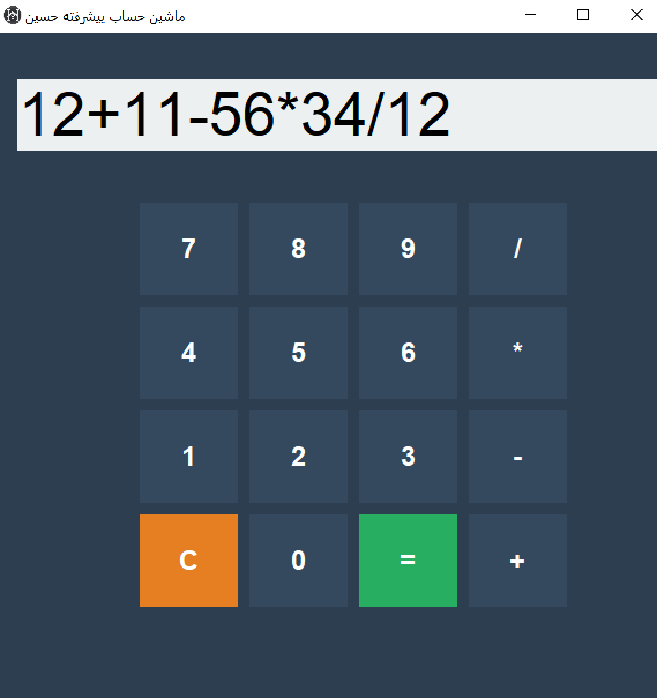

**English** · [فارسی](#فارسی)

# 🧮 HamletTech Calculator

A modern desktop calculator written in Python with Tkinter, optimised for Windows.

**Features:** full keyboard support (digits, operators, Enter = equals, Backspace), flat UI with hover effects, custom taskbar icon on Windows (via `ctypes`), bundled `logo.png`, and a single-file `.exe` build with PyInstaller.

**Run from source**
```bash
git clone https://github.com/ho3einahmadi/Calculator_hamlettech.git
cd Calculator_hamlettech
python main.py
```
**Build an .exe:** `pyinstaller --onefile --windowed --add-data "logo.png;." main.py`



---

<a id="فارسی"></a>

<div dir="rtl">

## 🧮 ماشین حساب پیشرفته هملت‌تک (HamletTech Calculator)

یک ماشین حساب گرافیکی مدرن و هوشمند که با Python و کتابخانه Tkinter توسعه یافته است. این پروژه فراتر از یک ماشین حساب ساده است و برای تجربه کاربری بهتر در ویندوز بهینه شده است.

---

## ✨ قابلیت‌های برجسته

* ⌨️ پشتیبانی هوشمند از کیبورد: * قابلیت تایپ مستقیم اعداد و عملگرها.
    * استفاده از کلید Enter برای محاسبه (مساوی).
    * استفاده از Backspace برای پاک کردن کاراکتر آخر.
    * هماهنگی کامل با دکمه‌های گرافیکی هنگام تایپ.
* 🎨 طراحی مدرن (Flat UI):
    * رنگ‌بندی جذاب و استفاده از فونت‌های خوانا.
    * افکت‌های هوور (Hover) حرفه‌ای برای تمام دکمه‌ها.
* 🖼️ مدیریت آیکون و منابع:
    * نمایش آیکون اختصاصی در نوار وظیفه (Taskbar) ویندوز با استفاده از ctypes.
    * جاسازی خودکار تصاویر (logo.png) داخل فایل خروجی برای جابجایی آسان.
* 📦 نسخه بدون نیاز به نصب:
    * ارائه شده در قالب یک فایل تک‌فایل اجرایی (`.exe`) برای ویندوز.

---

## 📸 پیش‌نمایش محیط برنامه


---

## 🛠 ابزارهای استفاده شده

* Language: Python 3.10+
* GUI Library: Tkinter
* System Integration: ctypes (برای رفع مشکل آیکون در ویندوز)
* Packaging: PyInstaller

---

## 🚀 راهنمای نصب و اجرا

### ۱. اجرای سورس کد
ابتدا مخزن را کلون کنید:
```bash
git clone https://github.com/ho3einahmadi/Calculator_hamlettech.git
cd Calculator_hamlettech
python main.py


</div>
